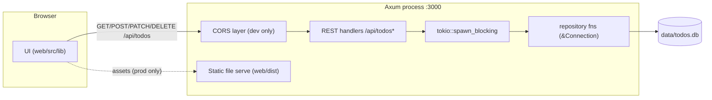

# Architecture

A single-user To Do List in one repository: a **Rust/Axum REST API** backed by a local **SQLite** file, plus a **static Astro** client written in TypeScript. The *why* behind the major choices lives in [ADR 0001](adr/0001-rusqlite-synchronous-driver.md) (synchronous rusqlite behind `spawn_blocking`), [ADR 0002](adr/0002-static-vanilla-client.md) (static Astro, vanilla TS client), and [ADR 0003](adr/0003-single-flat-list.md) (one flat list, no List entity).

Glossary words (todo, title, description, done, active, reopen) are canonical in [CONTEXT.md](../CONTEXT.md).

## Repository layout

```
├── server/            Rust API — Cargo package `todo-server`
│   ├── src/
│   │   ├── main.rs        entry: env config, state wiring, routing, static serving
│   │   ├── db.rs          SQLite: open/migrate, Mutex<Connection>, repository functions
│   │   ├── handlers.rs    the six /api/todos routes (extractors → repository → JSON)
│   │   ├── models.rs      Todo, TodoCreate, TodoUpdate DTOs (serde)
│   │   └── error.rs       AppError → status + {"error": "..."}
│   ├── Cargo.toml
│   └── tests/api.rs       integration tests (in-memory DB + axum::Router over real HTTP)
│
├── web/               TypeScript client — Astro 6 static build
│   ├── src/
│   │   ├── pages/index.astro   the only page: <html> shell, markup, loads client.ts
│   │   ├── lib/
│   │   │   ├── api.ts       fetch wrappers for the six routes
│   │   │   ├── store.ts     list state (todos, filter) + transitions
│   │   │   └── render.ts    row rendering, filtering, "N active" counter
│   │   └── client.ts        entry: DOM wiring, event handlers, initial fetch
│   └── astro.config.ts      output: "static"
│
├── docs/              this documentation (architecture, api, adr/)
├── CONTEXT.md         canonical glossary
└── data/              (gitignored — the runtime SQLite file lives here)
```

There is no component framework on the client: "Astro" here is a build tool, and the UI is plain HTML plus hand-written TS modules (ADR 0002).

## Dev and production

- **Development** — two processes: Axum on `127.0.0.1:3000` (API, CORS enabled so the `:4321` browser can reach it) plus `astro dev` on `127.0.0.1:4321` (serves the client, HMR).
- **Production** — one process: Axum on `:3000` serves both the API and the built client (`web/dist`) for non-`/api` paths. No CORS needed.



In dev the browser fetches the API directly at `:3000` (CORS header); in production the browser and API are same-origin, and the same handler code runs unchanged.

## Server internals

- **Concurrency** — a single `Connection` behind a `Mutex`, entered from async handlers via `tokio::spawn_blocking`; SQLite serializes writes through the file anyway, so a pool would buy nothing (ADR 0001). Repository functions take `&Connection`, which keeps the data layer unit-testable with no runtime.
- **Data flow** — extractors (`Path(id)`, `Query`, `Json(body)`) → validation → `spawn_blocking` (repository fn) → `Todo` DTO → `Json`/`StatusCode`. Failures map through `AppError` (error.rs): 400 validation, 404 missing todo, plus Axum's built-in 405/415.
- **Migrations** — a tiny hand-rolled `PRAGMA user_version`: step 1 creates the `todos` table (M2). No migration framework for one table; a real one is an architecture change, not a refactor.

## Client

`web/src/lib/api.ts` wraps `fetch` for the six routes. `store.ts` holds the current list and the filter (all/active/done) and the transitions (add, toggle done, delete). `render.ts` paints rows, applies the filter, and maintains the "N active" counter. `client.ts` wires DOM events and performs the initial fetch on load.

No component framework, no router, no state library — the document is small enough not to need them. Because there is no SSR (ADR 0002), the client must handle the API being unreachable: an error banner with a retry button, and optimistic-ish updates that reconcile against responses.

## Data model

| column | type | constraints |
|---|---|---|
| `id` | INTEGER | PRIMARY KEY (autoincrement) |
| `title` | TEXT | NOT NULL, 1..=200 chars (enforced at the API boundary) |
| `description` | TEXT | NULL when absent, ≤ 2000 chars |
| `done` | INTEGER | 0/1, NOT NULL, default 0 |
| `created_at` | TEXT | RFC 3339 UTC, set at creation |
| `updated_at` | TEXT | RFC 3339 UTC, bumped on every update |

Storage notes:

- `done` is stored as INTEGER 0/1 (SQLite has no boolean) and mapped to `bool` in the DTOs.
- Timestamps are TEXT in UTC with millisecond precision (`2026-08-30T10:00:00.000Z`); RFC 3339 UTC strings sort lexicographically in chronological order, so comparisons and ordering need no conversion.
- Listing order is `(created_at, id)` — oldest first.
- One table; no foreign keys needed because there is one flat list (ADR 0003).

## API surface

| Method | Path | Purpose | Success |
|---|---|---|---|
| GET | `/api/todos` | List (optional `?status=all\|active\|done`) | 200 `[Todo]` |
| POST | `/api/todos` | Create | 201 `Todo` |
| GET | `/api/todos/{id}` | One todo | 200 `Todo` |
| PATCH | `/api/todos/{id}` | Partial update | 200 `Todo` |
| DELETE | `/api/todos/{id}` | Hard delete | 204 |

The complete contract — schemas, error shapes, examples — is [api.md](api.md).

## Configuration (environment variables)

| variable | default | meaning |
|---|---|---|
| `TODO_ADDR` | `127.0.0.1:3000` | bind address |
| `TODO_DB_PATH` | `data/todos.db` | SQLite file, created on first start |
| `TODO_STATIC_DIR` | `web/dist` | built client, served for non-`/api` paths |

Defaults are **relative to the current working directory**. The README quickstarts run the server from the repository root, so they resolve to `data/todos.db` and `web/dist` with no variables set. Run from `server/` instead and the same defaults resolve under `server/` — the server logs a clear warning at startup when the static dir is missing.

## Toolchain

Verified on this machine on 2026-08-30. Exact dependency versions land in `server/Cargo.lock` and `web/package-lock.json` after M2/M3; the M4 release notes lock them down.

| tool | version | used for |
|---|---|---|
| rustc / cargo | 1.98.0 | building the server |
| node / npm | 24.20.0 / 12.0.2 | building the client |
| SQLite (system lib) | 3.51.0 | runtime database; `sqlite3` CLI for inspection |
